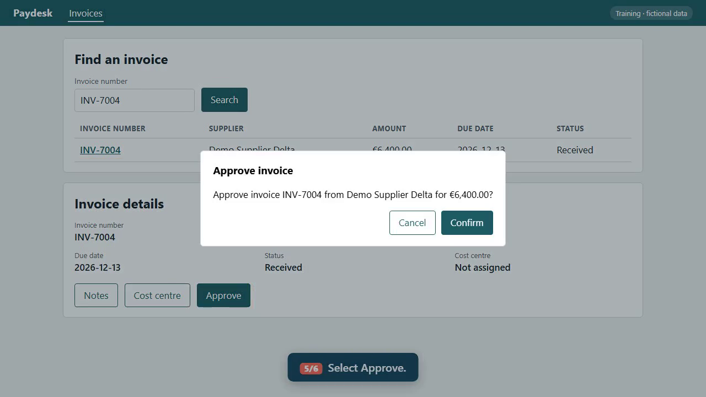
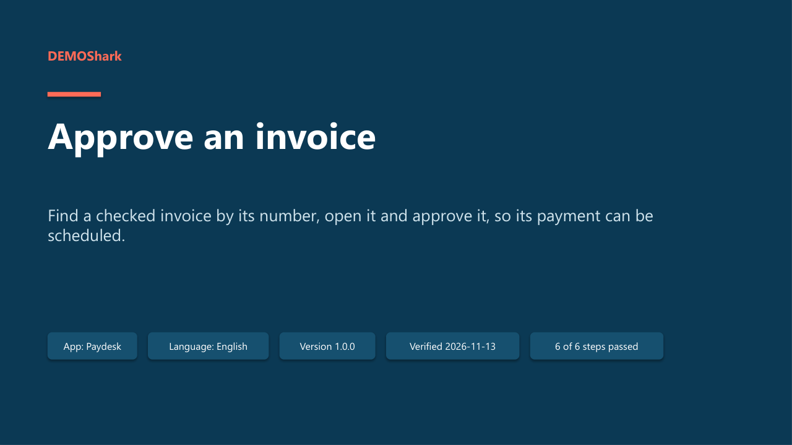
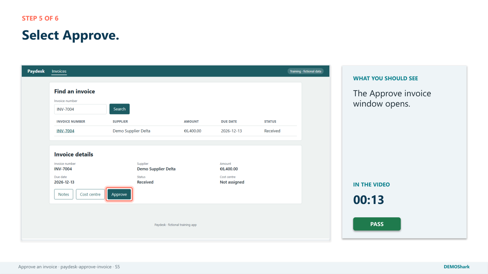
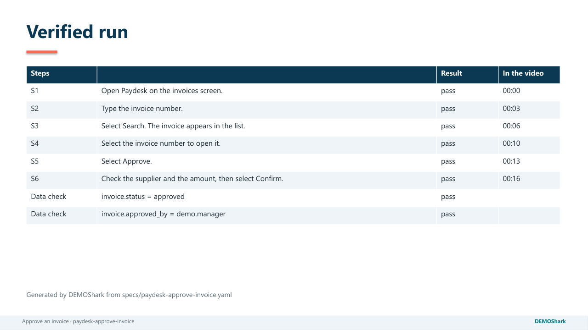

# DEMOShark 🦈

**One spec in. A narrated video, a PowerPoint deck and a step-by-step guide out, in every language, and each one proven by a real run of the application.**



Training material for business software goes stale with the next release, and nobody notices until someone follows an outdated guide. DEMOShark treats a walk-through like code:

- **The spec is the single source.** One YAML file describes the task: what the narrator says at each step, which control to use (by its visible name), and what must appear next. The caption, voice, subtitle, slide and guide step all come from that one line.
- **Every output is a test.** DEMOShark drives the real app in a browser and checks each step on screen and the result in the data. If a release renames a button, the run fails at that exact step and publishes nothing, so nobody follows an outdated guide.
- **Every language from the same spec.** Add a translation and a language code: the app is recorded in that language, with a neural voice for it. The sample runs in English, Spanish and Thai.
- **All outputs build in parallel.** Once the languages are recorded, the videos, decks and guides of every language are built at the same time.

| | English | Español | ไทย |
|---|---|---|---|
| Video (narrated, subtitles) | [walkthrough-en.mp4](docs/media/walkthrough-en.mp4) | [walkthrough-es.mp4](docs/media/walkthrough-es.mp4) | [walkthrough-th.mp4](docs/media/walkthrough-th.mp4) |
| PowerPoint (notes = narration) | [deck en](docs/media/paydesk-approve-invoice-en.pptx) | [deck es](docs/media/paydesk-approve-invoice-es.pptx) | [deck th](docs/media/paydesk-approve-invoice-th.pptx) |

<p>



</p>

## Try it in two minutes

```bash
git clone https://github.com/shawndale-glitch/demoshark.git && cd demoshark
python -m venv .venv && . .venv/bin/activate        # Windows: .venv\Scripts\Activate.ps1
pip install -e ".[dev]" && python -m playwright install chromium
python -m demoshark demo
```

`demo` starts **Paydesk**, a small fictional accounts-payable app bundled with the tool. It then records the sample spec in three languages and writes everything to `build/paydesk-approve-invoice/<lang>/`. To see drift detection, run `python -m demoshark demo --drift --voice none`: Paydesk renames its Approve button, as a vendor release might, and the run stops at that step.

Full instructions: [docs/INSTALL.md](docs/INSTALL.md). Dev Container / Codespaces ready.

## The spec at the centre

```yaml
walkthrough:
  id: paydesk-approve-invoice
  title: { en: Approve an invoice, es: Aprobar una factura, th: อนุมัติใบแจ้งหนี้ }
  environment: training            # production is always rejected
  languages: [en, es, th]
voice: { preset: smooth }          # warm neural narration; offline fallback
fixtures:
  invoice: { supplier: Demo Supplier Delta, amount: 6400 }   # created before, deleted after
steps:
  - id: S5
    say:    { en: Select Approve., es: Pulse Aprobar., th: กดอนุมัติ }
    do:     { action: click, target: { role: button, name: { en: Approve, es: Aprobar, th: อนุมัติ } } }
    expect: { target: { role: dialog, name: { en: Approve invoice, ... } } }
    result: { en: The Approve invoice window opens., ... }
verify:
  - { fixture: invoice, field: status, equals: approved }    # proven in the data, not just on screen
```

```text
spec.yaml ─► check ─► record each language ─► build in parallel ─► video · deck · guide · QA report
           DS1–DS10    caption · ring · voice      (all languages     per language
           (no run if  · act · expect · verify     × all outputs)
            errors)
```

[`specs/paydesk-approve-invoice.yaml`](specs/paydesk-approve-invoice.yaml) is the full sample. [`docs/SPEC-REFERENCE.md`](docs/SPEC-REFERENCE.md) covers every field and the ten rules.

## What's in the box

| Path | What |
|---|---|
| `demoshark/` | The tool: rule checks, voice, browser runner, video, deck, guide, parallel build |
| `demoshark/demoapp/` | Paydesk, the fictional app the sample runs against (EN/ES/TH, with a `--drift` mode) |
| `specs/` | The sample spec |
| `templates/spec-template.yaml` | A blank spec to start from |
| `templates/requests/` | **Access-request templates**: test environment, test accounts, API sandbox, runner machine, voice-service approval, review rules, privacy |
| `docs/` | [Install](docs/INSTALL.md) · [User guide](docs/USER-GUIDE.md) · [Spec reference](docs/SPEC-REFERENCE.md) · [Your own app](docs/ADAPTING.md) · [Architecture](docs/ARCHITECTURE.md) |
| `tests/` | Rule and output tests (no browser needed) |
| `.github/workflows/ci.yml` | Checks the spec, runs the tests, records a captions-only demo, and confirms that drift fails |

## Commands

| Command | Does |
|---|---|
| `python -m demoshark check SPEC` | Applies the rules. Nothing runs. |
| `python -m demoshark run SPEC [--lang es] [--headed] [--voice none]` | Records and builds |
| `python -m demoshark build SPEC` | Rebuilds the outputs from the last recording |
| `python -m demoshark demo [--drift]` | The sample, end to end, against the bundled app |
| `python -m demoshark voices [--sample --lang en]` | Lists voice engines, or writes a sample clip per voice preset |

## Built with

Python · Playwright · ffmpeg (via imageio-ffmpeg) · python-pptx · Microsoft neural voices (via edge-tts) · JSON Schema

## Related

[figjam-process-pipeline](https://github.com/shawndale-glitch/figjam-process-pipeline) takes process diagrams to validated documentation. DEMOShark is the next step: from one task in that process to training material that tests itself.

---

© 2026 Shawn Dale. All rights reserved. See [LICENSE](LICENSE). Paydesk and all its data are fictional.
