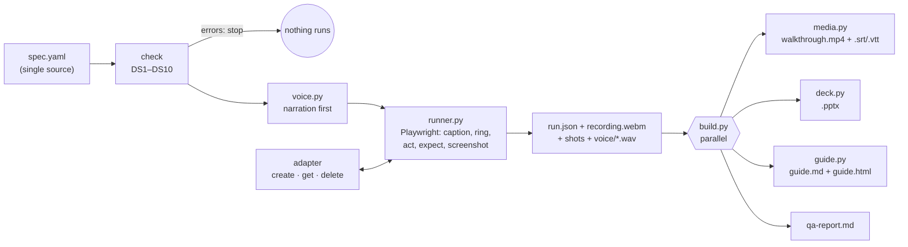

# Architecture

## Design decisions

| Decision | Why |
|---|---|
| **One spec per walk-through, and everything generated from it** | A narration change is one line, and the voice, caption, subtitle, slide and guide change together. Reviewing the spec reviews all the outputs. |
| **Narration is synthesised before the browser runs** | Each step lasts exactly as long as its voice line, so the audio never needs stretching or cutting. |
| **Controls found by role and visible name, never CSS** | The recording breaks when a person would get lost, so a renamed button surfaces as a failed step, not as an outdated video. |
| **An expect check on every step, plus a data check** | The video shows what happened, and the run proves it: on screen after each step, and in the data at the end. |
| **Recording is sequential; building is parallel** | One browser at a time keeps recordings stable on small machines. The outputs only read files, so all languages × outputs build at the same time (`ThreadPoolExecutor`). |
| **A failed language publishes nothing** | An output exists only if every step and check passed. The QA report says where it stopped. |
| **ffmpeg from a pip package; Chromium from Playwright** | Nothing to install by hand, and the same on every OS and in CI. |
| **Voice engines are swappable, with an offline fallback** | Online neural voices sound best. Windows voices and captions-only cover locked-down networks. |

## Modules

| Module | Responsibility |
|---|---|
| `spec.py` | Load the spec, resolve texts per language and placeholders, apply the rules |
| `voice.py` | Presets and engines (edge, sapi, none); one WAV per step |
| `runner.py` | Fixtures in, recorded run, step checks, screenshots, verify, cleanup |
| `media.py` | ffmpeg: narration placed at each step's second, MP4 with a subtitle track |
| `deck.py` | python-pptx deck, speaker notes = narration |
| `guide.py` | Markdown and HTML guide; each step links to its second in the video |
| `build.py` | QA report; builds all outputs of all languages in parallel |
| `adapters/` | Test data per application (`paydesk`, `none`, yours) |
| `demoapp/` | Paydesk, a fictional accounts-payable app in three languages, with a `--drift` mode |
